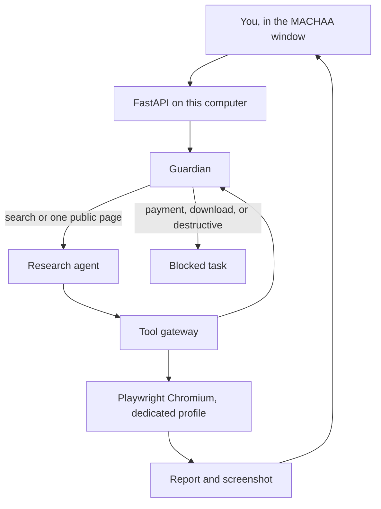

# MACHAA

Machaa is an open-source personal AI computer you run on your own machine. You type a request in a local chat window. Machaa opens a browser that belongs to it, does the task, and shows you the screenshot and a short report.

Day 1 is deliberately small. It can search Google and open one public website. It cannot spend money, download files, or control your desktop. Those limits are in code, not only in a prompt.

Search needs no API key and no cloud account. A Word document needs a free Gemini key, explained below. Machaa does not log in to ChatGPT, Gmail, or a bank.

## Quick start

Install [Docker Desktop](https://www.docker.com/products/docker-desktop/) and open it. Then:

| | What you do |
| --- | --- |
| **Windows** | Unzip this project. Double-click `start.bat`. |
| **Mac** | Open Terminal in this folder and run `./start.sh`. |
| **Linux** | Open a terminal in this folder and run `./start.sh`. |

Leave that window open. In your web browser, go to:

**http://127.0.0.1:8787**

Type this and press Send:

```text
Open Google and search for simple 2BHK interior design ideas
```

Machaa opens Chromium and searches Google. The report lists the result titles and links, and the card shows a screenshot of that results page. The browser profile lives in Machaa's data folder (`data/browser-profile`, or the Docker volume) and is kept for the next time you start Machaa. That profile belongs to Machaa. A personal Chrome profile is refused.

If Google shows a robot check or a consent page, Machaa leaves that page alone and uses DuckDuckGo's public results instead. The card still says **Completed** when those results come back. A person is asked only when every source comes back empty. No API key is required. A free Brave Search key or a free Google Programmable Search key can be added in `.env` if you want those official APIs used first. See `.env.example`.

To stop Machaa, click the terminal window and press Ctrl+C.

You do not need Python, an API key, or a GitHub login to run it this way.

## Word documents

Ask Machaa:

```text
Write a Word document about simple 2BHK interior design ideas
```

Machaa searches, asks Gemini to write from those results, and puts a Download button on the card. The Word file stays on your computer. The usual model is Gemini 3.5 Flash-Lite. If Google says that model is missing, Machaa tries the next current model and shows Google's own message on the card if none of them answer.

The same key writes a social post. Ask:

```text
Machaa, prepare an Instagram content document for Vistaara Interiors about affordable premium-looking 2BHK interiors. Research design ideas, find a suitably licensed reference image, and create 3 captions with hashtags.
```

Machaa checks a short plan before it starts. The plan can search, save a screenshot, look for a reference image, and write the Word file. Every action is checked again when it runs. A shell command is never on that list.

The Word file has three post ideas, captions, hashtags, image suggestions, and the source links. A picture is embedded only when Machaa finds one on Wikimedia Commons or Openverse with a public-domain, CC0, CC BY, or CC BY-SA licence. The artist and the licence are written in the file. If nothing reusable is found, the file contains a grey box labelled as a placeholder, not a photograph.

While a task is running you can press Pause, then Resume, or Stop. A task also stops if it takes more than 120 seconds, more than 8 actions, more than about 8,000 Gemini tokens, or if Gemini says the free quota is used up. A quota problem is retried once, then the card shows Gemini's message.

The first time, the page shows where to put the key:

1. Open https://aistudio.google.com/apikey and create a free key.
2. In the Machaa folder (the same folder as `start.bat`), create a file named `.env` if you do not already have one.
3. Add this line, with your key after the equals sign: `GEMINI_API_KEY=`
4. On Windows, click the black Machaa window, press Ctrl+C, then double-click `start.bat` again.

Leave the key out and search still works. The Word request then says **Needs a key** and does not call Gemini.

## Try a blocked request

```text
Buy a sofa and pay with my credit card at checkout
```

The card turns **Blocked**. Chromium does not open. The same thing happens for a checkout link, a file download, or a request to erase the disk.

## What Day 1 does

- Search Google, and use DuckDuckGo (or an optional free search API) when Google shows a check.
- Open one public `http` or `https` website.
- Read the visible text.
- Save a Markdown research report and a screenshot.
- Show the task, the plan, each step's status, a screenshot, the files, and a Stop, Pause, and Resume button.
- Keep a local history of task ids.
- Prepare an Instagram (or other platform) content document with three captions.

A task stops on its own if it takes more than 120 seconds, more than 8 actions, or more than its Gemini token budget.

## What it will not do

- Buy, pay, check out, or type a credit card.
- Open banking, PayPal, Gmail, ChatGPT, or Gemini.
- Download a file.
- Run a shell command, even when a plan asks for one, or delete files, or shut the computer down.
- Attach to your personal Chrome, Chromium, or Edge profile.
- Call a paid AI API. Search is free. A Word document or social post uses the free Gemini key in `.env`. See [ROADMAP.md](ROADMAP.md).

## How it is put together



The pieces that are only seams today: the orchestrator, a computer agent, a work/code agent, Postgres with pgvector, a background queue, an optional cloud runtime, and a desktop companion. The folders are in the repository. They do not run yet. [ROADMAP.md](ROADMAP.md) says what they are for, including saying "open Machaa" out loud.

## Safety

The Guardian's allowlist is checked in the tool gateway before a browser action runs. Wording the request nicely does not bypass it. Page text is saved into the report. It is not treated as a new command.

The Docker setup is local and restricted:

- The process runs as user `machaa`, not root.
- Memory is limited to 2 GB, CPU to 2, and the process count is capped.
- The filesystem is read-only except for Machaa's data volume and a small temp folder.
- The Docker socket is not mounted. The container is not privileged.
- The site is published on `127.0.0.1` only.

Day 1 has no password. Do not forward port 8787 to the internet. Details are in [SECURITY.md](SECURITY.md).

## Develop

For people changing the code. You need Python 3.11 or newer.

```bash
python -m venv .venv
source .venv/bin/activate          # Windows: .venv\Scripts\activate
pip install -r requirements-dev.txt
python -m playwright install chromium
pytest
```

`python -m machaa` starts the same dashboard without Docker, at http://127.0.0.1:8787. Copy `.env.example` to `.env` only if you want to change a port, a limit, or an optional search key. Leave the key lines empty to run with no key. Do not commit a filled-in `.env`.

Runtime files under `data/` (the browser profile, cookies, screenshots, reports, and the database) are gitignored. Do not commit them.

## License

Apache-2.0. See [LICENSE](LICENSE). Contributions are welcome under the same license. Read [CONTRIBUTING.md](CONTRIBUTING.md) before opening a pull request.
