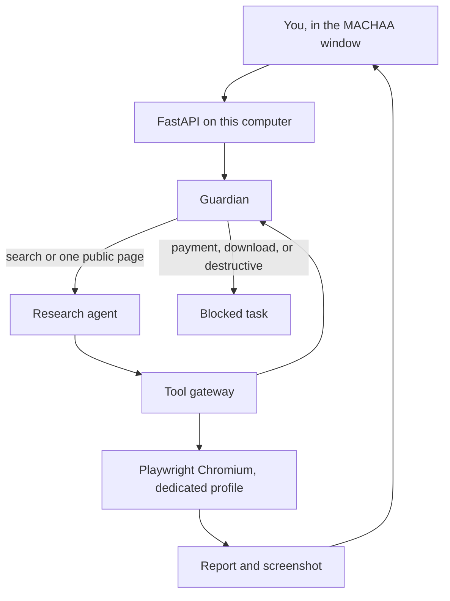

# MACHAA

Machaa is an open-source personal AI computer you run on your own machine. You type a request in a local chat window. Machaa opens a browser that belongs to it, does the task, and shows you the screenshot and a short report.

Day 1 is deliberately small. It can search Google and open one public website. It cannot spend money, download files, or control your desktop. Those limits are in code, not only in a prompt.

Search needs no API key and no cloud account. A Word document needs a free Gemini key, explained below. Machaa does not log in to ChatGPT, Gmail, or a bank.

## Days 4–6 on Windows

1. Unzip https://github.com/Karthikrapolu-ai/machaa/archive/refs/heads/cursor/machaa-day6.zip and copy your `.env` file into that folder.
2. Double-click `START-MACHAA.bat`. The browser opens at **http://127.0.0.1:8787**. The header shows `v0.6.0`. Close any old Machaa tab.
3. Turn **Desktop control** on in Settings. If a card says **Needs approval**, press **Approve**.
4. Ask Machaa to research modern 2BHK interiors, prepare 3 Instagram posts for Vistaara Interiors, create a DOCX, save it in Documents/Machaa, and open it.
5. Then you can ask it to open Notepad and write a summary of that document, or ask what it created in the last task.

Click the microphone in the message box and speak. The words appear in the box. Stop keeps them. Send in that bar sends them. Cancel throws them away. **Stop** on a card stops the work and says which steps finished. Leave the Machaa Companion window open. To quit, double-click `STOP-MACHAA.bat`.

These still need your PC: the microphone, Notepad, Word opening the file, File Explorer, and Docker Desktop.

## Windows, in three steps

1. Unzip this download. If you already have a Machaa folder, copy your `.env` file into the new folder. Leave it as it is.
2. Double-click `START-MACHAA.bat`.
3. Your browser opens at **http://127.0.0.1:8787**.

If the window says Python or Docker is missing, it tells you what to install. Then double-click `START-MACHAA.bat` again. That replaces the old dashboard instead of leaving it on port 8787. To stop, double-click `STOP-MACHAA.bat`.

Click the microphone inside the message box to speak. Chrome or Edge shows the words in the box while you talk. Stop leaves them there so you can edit. Send in the microphone bar sends them. Cancel throws them away. The timer stops in every case. Mute, Desktop control, Start Companion, and Listen for Open Machaa are under Settings.

The card shows the real step Machaa is on, such as Searching… or Creating Word document…, and how many seconds it has been working. Stop stays on the card. There is no percentage.

An Instagram request produces three different ideas. Each one has a hook, a short caption, a long caption, hashtags, a call to action, a format (reel, carousel, or static), and a visual direction. You can add `in a warm tone` to the sentence. Machaa does not invent a price. A picture is used only when the licence allows it, and the credit stays in the Word file.

Settings has **Check for updates**. It shows the version you have and the version on the official Machaa repository. Nothing is downloaded until you press **Update now**. A draft, a pull request, or someone else's fork is ignored. **Track a draft branch** is for testing during the build and stays off unless you turn it on. Your `.env` file, browser profile, documents, database, and history are kept. If the new version does not start, Machaa puts the previous one back.

## Quick start

Install [Docker Desktop](https://www.docker.com/products/docker-desktop/) and open it. Then:

| | What you do |
| --- | --- |
| **Windows** | Unzip this project. Double-click `start.bat`. |
| **Mac** | Open Terminal in this folder and run `./start.sh`. |
| **Linux** | Open a terminal in this folder and run `./start.sh`. |

Leave that window open. In your web browser, go to:

**http://127.0.0.1:8787**

Type this and press Send:

```text
Open Google and search for simple 2BHK interior design ideas
```

Machaa opens Chromium and searches Google. The report lists the result titles and links, and the card shows a screenshot of that results page. The browser profile lives in Machaa's data folder (`data/browser-profile`, or the Docker volume) and is kept for the next time you start Machaa. That profile belongs to Machaa. A personal Chrome profile is refused.

If Google shows a robot check or a consent page, Machaa leaves that page alone and uses DuckDuckGo's public results instead. The card still says **Completed** when those results come back. A person is asked only when every source comes back empty. No API key is required. A free Brave Search key or a free Google Programmable Search key can be added in `.env` if you want those official APIs used first. See `.env.example`.

To stop Machaa, click the terminal window and press Ctrl+C.

You do not need Python, an API key, or a GitHub login to run it this way.

## Word documents

Ask Machaa:

```text
Write a Word document about simple 2BHK interior design ideas
```

Machaa searches, asks Gemini to write from those results, and puts a Download button on the card. The Word file stays on your computer. The usual model is Gemini 3.5 Flash-Lite. If Google says that model is missing, Machaa tries the next current model and shows Google's own message on the card if none of them answer.

The same key writes a social post. Ask:

```text
Machaa, prepare an Instagram content document for Vistaara Interiors about affordable premium-looking 2BHK interiors. Research design ideas, find a suitably licensed reference image, and create 3 captions with hashtags.
```

Machaa checks a short plan before it starts. The plan can search, save a screenshot, look for a reference image, and write the Word file. Every action is checked again when it runs. A shell command is never on that list.

The Word file has three post ideas, captions, hashtags, image suggestions, and the source links. A picture is embedded only when Machaa finds one on Wikimedia Commons or Openverse with a public-domain, CC0, CC BY, or CC BY-SA licence. The artist and the licence are written in the file. If nothing reusable is found, the file contains a grey box labelled as a placeholder, not a photograph.

While a task is running you can press Pause, then Resume, or Stop. A task also stops if it takes more than 120 seconds, more than 8 actions, more than about 8,000 Gemini tokens, or if Gemini says the free quota is used up. A quota problem is retried once, then the card shows Gemini's message.

The first time, the page shows where to put the key:

1. Open https://aistudio.google.com/apikey and create a free key.
2. In the Machaa folder (the same folder as `start.bat`), create a file named `.env` if you do not already have one.
3. Add this line, with your key after the equals sign: `GEMINI_API_KEY=`
4. On Windows, click the black Machaa window, press Ctrl+C, then double-click `start.bat` again.

Leave the key out and search still works. The Word request then says **Needs a key** and does not call Gemini.

## Windows desktop and voice

Double-click `START-MACHAA.bat`. It starts the Windows Companion in its own window, replaces any old dashboard still using port 8787, waits until the new page answers, then opens **http://127.0.0.1:8787**. The header shows the version, such as `v0.6.0`. Your existing `.env` file stays where it is, including `GEMINI_API_KEY`. The same file adds a Startup shortcut so the Companion can start when you sign in. Delete the shortcut named Machaa Companion if you do not want that. **Start Companion** on the page cannot launch it from Docker; the window and the Startup shortcut do that.

The first time:

1. If Python is missing, Machaa tries to install Python 3.12. If that does not finish, install Python and tick **Add python.exe to PATH**, then double-click `START-MACHAA.bat` again.
2. When you click the microphone, Windows asks for the microphone. Choose **Allow**.
3. Leave User Account Control on. Machaa will not click a Windows security box.
4. In the page, turn **Desktop control** on before you ask Machaa to open Notepad. It starts off, and you can turn it off again at any time.

You can type these:

```text
Machaa, open Notepad.
Machaa, write three Instagram caption ideas for Vistaara Interiors in Notepad.
Machaa, save this to my Machaa Documents folder.
Machaa, open Calculator.
Machaa, open Google and search for modern bedroom interiors.
Machaa, stop.
```

Saving or typing waits until you press **Approve**. Reject leaves the file alone. Stop cancels a desktop action that has not run yet. Files go only in your `Documents\Machaa` folder. Machaa types only into the Notepad window it opened.

Click the microphone to speak. The words appear in the box. Stop keeps them, Send in that bar submits them, and Cancel throws them away. The timer stops in every case. If the browser speech engine returns nothing within a few seconds, or it reports a network or permission error, Stop and Send turn the recording into text with the Gemini key in `.env`. Settings has **Test microphone**, which shows the mic level and whether the speech engine is available. **Mute** stops the spoken reply immediately. An error is shown on the page if transcription fails. Recordings are not saved.

**Listen for Open Machaa** stays off unless you turn it on. With the companion running, typing or saying Open Machaa brings the dashboard forward.

If the card says the Windows Companion is not running, double-click `START-MACHAA.bat` and leave the Machaa Companion window open.

## Try a blocked request

```text
Buy a sofa and pay with my credit card at checkout
```

The card turns **Blocked**. Chromium does not open. The same thing happens for a checkout link, a file download, or a request to erase the disk.

## What Day 1 does

- Search Google, and use DuckDuckGo (or an optional free search API) when Google shows a check.
- Open one public `http` or `https` website.
- Read the visible text.
- Save a Markdown research report and a screenshot.
- Show the task, the plan, each step's status, a screenshot, the files, and a Stop, Pause, and Resume button.
- Keep a local history of task ids.
- Prepare an Instagram (or other platform) content document with three captions.

A task stops on its own if it takes more than 120 seconds, more than 8 actions, or more than its Gemini token budget.

## What it will not do

- Buy, pay, check out, or type a credit card.
- Open banking, PayPal, Gmail, ChatGPT, or Gemini.
- Download a file.
- Run a shell command, PowerShell, or a Windows settings change, even when a plan asks for one.
- Delete files, or shut the computer down.
- Type into a window it did not open, or save a file outside Documents\Machaa.
- Attach to your personal Chrome, Chromium, or Edge profile.
- Call a paid AI API. Search is free. A Word document or social post uses the free Gemini key in `.env`. See [ROADMAP.md](ROADMAP.md).

## How it is put together



The Windows Companion is a separate program on your PC. It is not inside the Docker worker. It listens only on this computer, and the dashboard talks to it with a token that stays in `data/` and is not committed. Unrestricted mouse control, a work/code agent, Postgres with pgvector, a background queue, and an optional cloud runtime are still not running. [ROADMAP.md](ROADMAP.md) says what they are for, including saying "open Machaa" out loud.

## Safety

The Guardian's allowlist is checked in the tool gateway before a browser action runs. Wording the request nicely does not bypass it. Page text is saved into the report. It is not treated as a new command.

The Docker setup is local and restricted:

- The process runs as user `machaa`, not root.
- Memory is limited to 2 GB, CPU to 2, and the process count is capped.
- The filesystem is read-only except for Machaa's data volume and a small temp folder.
- The Docker socket is not mounted. The container is not privileged.
- The site is published on `127.0.0.1` only.

Day 1 has no password. Do not forward port 8787 to the internet. Details are in [SECURITY.md](SECURITY.md).

## Develop

For people changing the code. You need Python 3.11 or newer.

```bash
python -m venv .venv
source .venv/bin/activate          # Windows: .venv\Scripts\activate
pip install -r requirements-dev.txt
python -m playwright install chromium
pytest
```

`python -m machaa` starts the same dashboard without Docker, at http://127.0.0.1:8787. Copy `.env.example` to `.env` only if you want to change a port, a limit, or an optional search key. Leave the key lines empty to run with no key. Do not commit a filled-in `.env`.

Runtime files under `data/` (the browser profile, cookies, screenshots, reports, and the database) are gitignored. Do not commit them.

## Checks that need your Windows PC

These were not run on the build machine, because it is not your PC:

- Click the microphone, choose Allow, watch the timer, press Stop, edit the words, then Send.
- Press Cancel and confirm the words were not kept.
- Choose Block when Windows asks for the microphone, and read the message on the page.
- Turn Mute on and off, and try Listen for Open Machaa after the optional voice program is installed.
- Open Notepad, Calculator, and File Explorer, approve typing and saving, and reject a save.
- Double-click `START-MACHAA.bat` twice and confirm only one Machaa starts. Then double-click `STOP-MACHAA.bat`.
- Check for updates, and only then press Update now. Confirm `.env` is still there.

## License

Apache-2.0. See [LICENSE](LICENSE). Contributions are welcome under the same license. Read [CONTRIBUTING.md](CONTRIBUTING.md) before opening a pull request.
